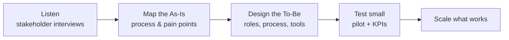

# Hi, I'm Bhabna Mukherjee

**Business analytics graduate student (Carleton University, MABA, Dec 2026) with an Information Technology degree.**
I map how work happens today, interview the people involved, and design what it should look like next, using data and AI where they genuinely help.

📍 Ottawa, ON · [LinkedIn](https://www.linkedin.com/in/bhabnamukherjee/) · bhabnamukherjee@cmail.carleton.ca

---

## Featured projects

| Project | What it shows | Result |
|---|---|---|
| [Sales Knowledge System, Leoserve Interactive](https://github.com/bhabnamukherjee/leoserve-sales-knowledge-system) | Client work · As-Is / To-Be process mapping · AI governance | Designed a founder-approved AI knowledge system and a 10-day pilot so a growing sales team doesn't depend on one person |
| [ClassCompass AI](https://github.com/bhabnamukherjee/classcompass-ai-design-thinking) | Design Thinking · stakeholder needs · phased rollout | AI advising tool built on existing university systems, with costs and a 3-phase plan |
| [Quantum Opportunity Landscape](https://github.com/bhabnamukherjee/quantum-opportunity-landscape) | LLM analysis pipeline · market strategy | Analyzed 1,673 industry articles; post-quantum cryptography is the nearest-term opportunity |
| [Snapchat Review Analytics](https://github.com/bhabnamukherjee/snapchat-topic-modeling-sentiment-analysis) | Data cleaning / ETL · sentiment · topic modelling | Cleaned 50,000 comments; showed star ratings hid real complaints |

**In progress:** Human-AI Teaming Capability Framework, my capstone for Carleton's ITEC (Dec 2026).

---

## How I work

## Skills

**Consulting & business analysis:** As-Is / To-Be process mapping, stakeholder interviews, requirements, use cases, Design Thinking, KPIs, business cases, roadmaps
**Data & analytics:** SQL, data cleaning and ETL, Excel, Google Sheets dashboards, Orange Data Mining, topic modelling, sentiment analysis
**AI:** LLM-assisted analysis with human verification, responsible AI governance
**Certifications:** Google Data Analytics · DataCamp SQL · Microsoft Go-to-Market Professional Certificate
